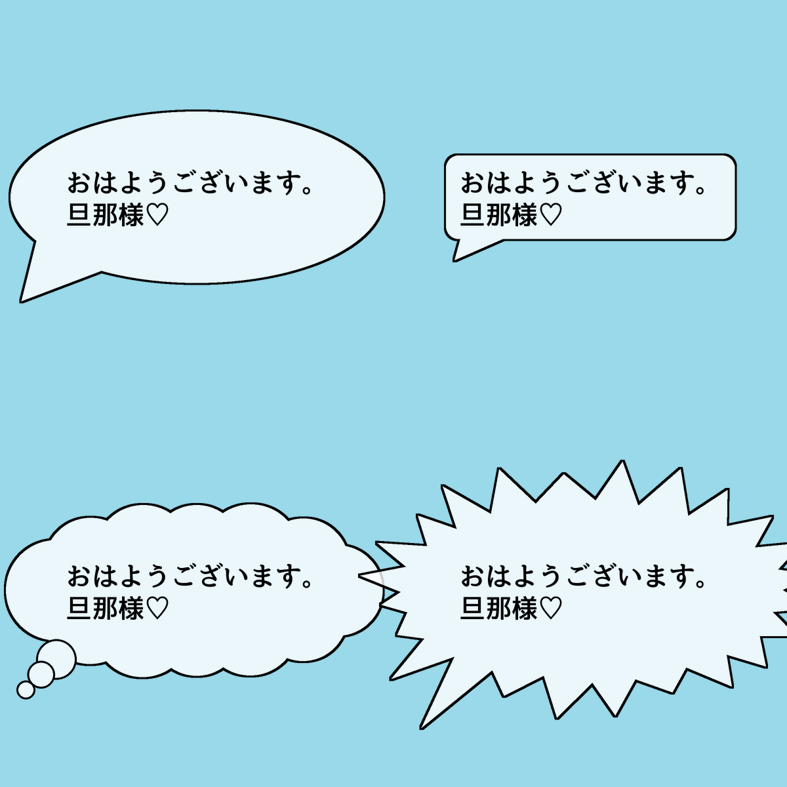
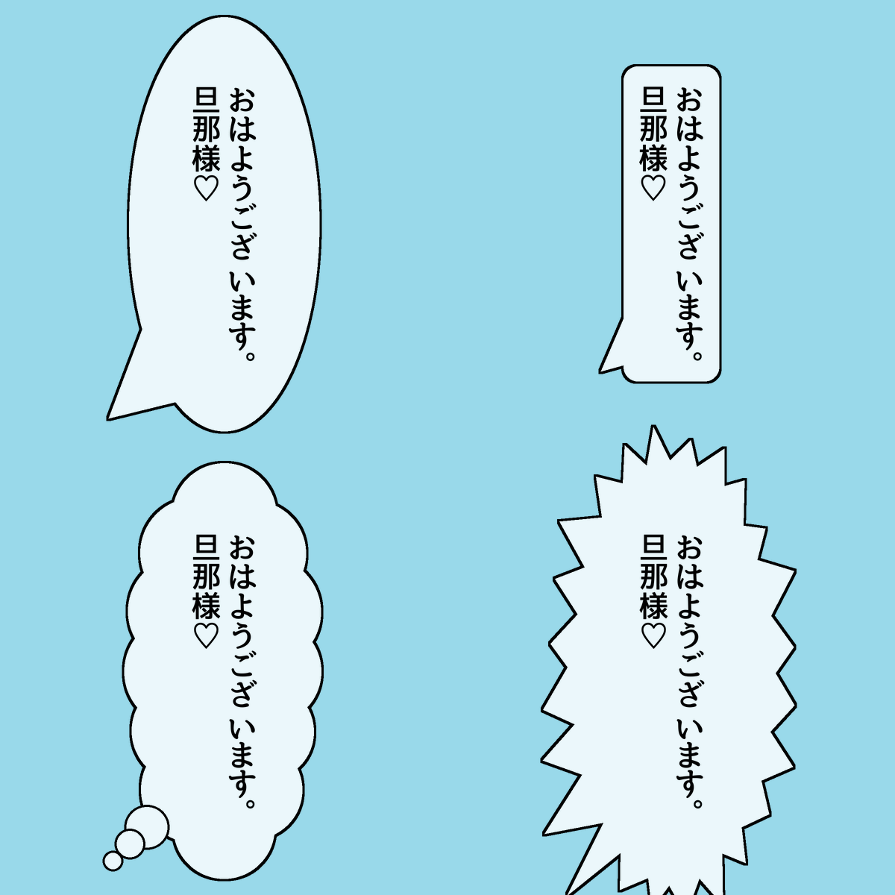
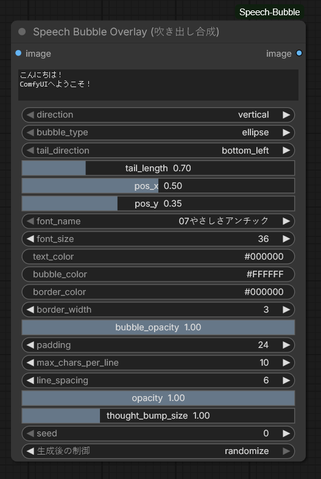

# ComfyUI-Speech-Bubble

[English (README.md)](README.md) | [日本語](README_JP.md)

---

画像生成AI（SDXL, Flux, SD1.5など）で生成した画像に対して、マンガ風の吹き出しと文字を後処理合成する **[ComfyUI](https://github.com/comfyanonymous/ComfyUI)** 用のカスタムノードです。
画像生成後のワークフロー上で、意図した通りの綺麗な吹き出しを自由に埋め込むことができます。

---

### 表示例・プレビュー

| 横書き吹き出し例（Horizontal） | 縦書き吹き出し例（Vertical） |
| :---: | :---: |
|  |  |

---

- **縦書き・横書きの前揃えレイアウト**:
  - 伝統的な日本語漫画の「右上から左下」へ流れる縦書き組版を完全サポート。
  - **前揃え（縦書きは上揃え、横書きは左揃え）**を採用。行頭に全角スペース（`　`）や空白を入れるだけで、自由自在に字下げや位置調整が可能です。
  - **句読点（、。）の確実な右下吸着**: 横書き専用フォントであっても、インク領域を精密に検出し、直前の文字の右下にピタリと寄り添うように自動配置。
  - 括弧類（`（）`、`「」`）、ダッシュ、長音記号（`ー`）の自動縦向き回転（全フォント互換）。
- **4種類の漫画吹き出し形状（シード別ランダム生成対応）**:
  - `ellipse`: 通常の滑らかな楕円吹き出し
  - `rounded_rect`: ナレーションや独白、チャット風の角丸長方形
  - `thought`: 心の声用のモコモコ雲型（大小のコブによる有機的な雲＋思考の泡）
  - `shout`: 叫び・驚き・大声用のトゲトゲ爆発型（手描きフラッシュ感のある鋭いトゲ）
  - **シード別ランダム形状**: `seed` パラメータ（ComfyUI標準の `randomize` 対応）により、生成ごとに異なる自然な手描きの雲型や叫びフラッシュが自動生成されます。
- **しっぽ（尻尾）の向きと長さの調整**:
  - キャラクターの口元に合わせて `bottom_left`（左下）、`bottom_right`（右下）、`top_left`（左上）、`top_right`（右上）、`none`（なし）から選択可能。
  - `tail_length`（尻尾の長さ）スライダーにより、遠くにいるキャラクターの口元まで柔軟に尻尾を伸ばせます。
- **吹き出し背景の透過率設定**:
  - `bubble_opacity` により、文字や枠線のクッキリ感を100%保ったまま、吹き出しの背景だけを半透明にしてイラストや髪の毛を透かすことが可能です。
- **正式フォント名の自動検出 & 独自フォント追加**:
  - TTF/OTFファイルのメタデータ（Name Table）を直接解析し、ファイル名ではなく「源暎アンチック v5」「07やさしさアンチック」「游ゴシック」「ＭＳ ゴシック」などの**正式な日本語名称**で選択リストに表示。
  - Windows, macOS, Linux のPCにインストールされているフォントを自動検出。
  - プロジェクト内の `fonts/` ディレクトリにお好みの漫画用フリーフォント（`.ttf`, `.otf` 等）を置くだけで即座に使用可能。
- **文字の縁取り（袋文字 / テキストストローク）対応**:
  - `text_border_width` と `text_border_color` により、文字の周囲に美しい縁取り線（アウトライン）を付与。
  - 縦書き（回転文字や促音・句読点を含む）および横書きの双方で滑らかにレンダリングされ、ポップなタイトル文字や叫びセリフの視認性を劇的に向上させます。
- **高品位アンチエイリアス処理**:
  - 2倍のスーパーサンプリングレンダリングとLanczos縮小フィルタにより、ジャギーのない滑らかで美しい境界線を実現。

---

### インストール方法

#### Git Clone によるインストール
ComfyUIの `custom_nodes` ディレクトリにクローンしてください：
```bash
cd ComfyUI/custom_nodes/
git clone https://github.com/miya805843/ComfyUI-Speech-Bubble.git
```
その後、ComfyUIを起動（または再起動）してください。

#### 動作要件
- `Pillow >= 9.5.0`
- `numpy`
- `torch`（ComfyUI環境に含まれています）

---

### ノードパラメータ一覧

<p align="center">
  
</p>

| パラメータ名 | 型 | デフォルト値 | 説明 |
| :--- | :--- | :--- | :--- |
| `image` | `IMAGE` | - | 前のノード（KSamplerなど）から受け取る元画像。 |
| `text` | `STRING` | 複数行 | セリフまたはテキスト内容。全角スペース（`　`）での字下げ調整に対応。 |
| `direction` | `ENUM` | `vertical` | 文字の方向：`vertical`（日本語縦書き）または `horizontal`（横書き）。 |
| `bubble_type` | `ENUM` | `ellipse` | 吹き出し形状：`ellipse`（楕円）、`rounded_rect`（角丸）、`thought`（雲型）、`shout`（叫び）。 |
| `tail_direction` | `ENUM` | `bottom_left`| しっぽの向き：`bottom_left`、`bottom_right`、`top_left`、`top_right`、`none`（なし）。 |
| `tail_length` | `FLOAT` | `0.7` | しっぽの長さ倍率（`0.0` 〜 `3.0`）。`0.0` でしっぽなし。 |
| `pos_x` / `pos_y` | `FLOAT` | `0.5`, `0.35`| 画像全体に対する吹き出しの中心位置（`0.0` 〜 `1.0`）。 |
| `font_name` | `ENUM` | システム既定 | 検出されたシステムフォントまたは `fonts/` フォルダ内のフォント名。 |
| `font_size` | `INT` | `36` | フォントサイズ（ピクセル単位）。 |
| `text_color` | `STRING` | `#000000` | 文字色（HEXカラーコードまたはカラー名）。 |
| `text_border_width` | `INT` | `0` | 文字の縁取りの太さ（ピクセル単位）。`0` で縁取りなし。 |
| `text_border_color` | `STRING` | `#FFFFFF` | 文字の縁取り（袋文字）の色。 |
| `bubble_color` | `STRING` | `#FFFFFF` | 吹き出し背景色。 |
| `bubble_border_width` | `INT` | `3` | 吹き出し枠線の太さ（ピクセル単位）。 |
| `bubble_border_color` | `STRING` | `#000000` | 吹き出し枠線の色。 |
| `padding` | `INT` | `24` | 文字と吹き出し境界の間のパディング（余白）。 |
| `max_chars_per_line` | `INT` | `10` | 自動改行・改列を行う文字数制限。 |
| `line_spacing` | `INT` | `6` | 行間または列間の余白。 |
| `thought_bump_size` | `FLOAT` | `1.0` | 雲型（thought）のコブ（丸）の大きさ、および叫び（shout）のトゲの山の高さ倍率（`0.2` 〜 `3.0`）。雲のモコモコ感や叫びのトゲトゲ度を自由に調整可能。 |
| `seed` | `INT` | `0` | 形状ランダムシード（生成後の制御: `randomize` / `fixed` 等対応）。 |
| `bubble_opacity`| `FLOAT` | `1.0` | （任意）吹き出し背景の不透明度（`0.0` 〜 `1.0`）。背景を透かしたい時に使用。 |
| `opacity` | `FLOAT` | `1.0` | （任意）吹き出し全体の不透明度（文字・枠線含む、`0.0` 〜 `1.0`）。 |

---

### ライセンス

本プロジェクトは [MIT License](LICENSE) の下で公開されています。
